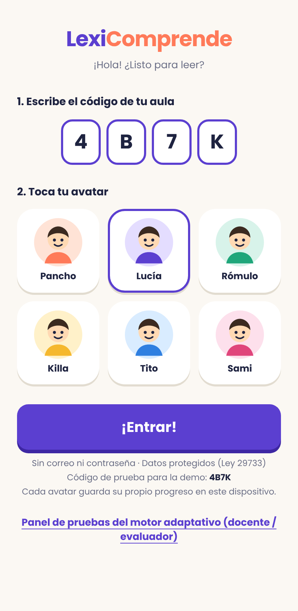
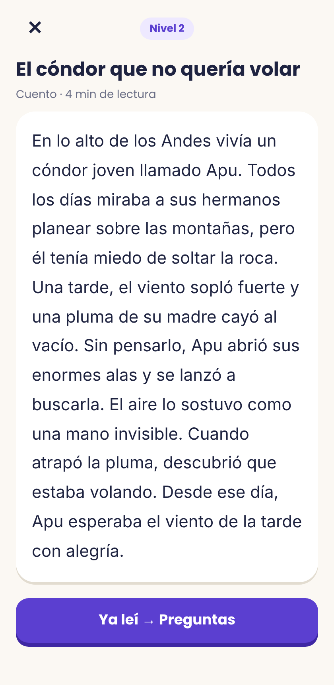
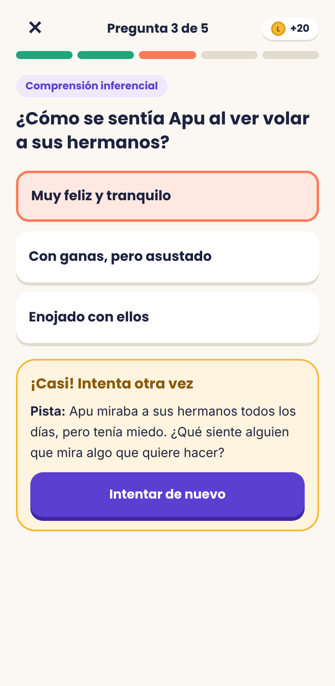
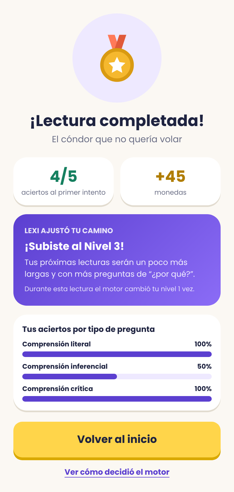
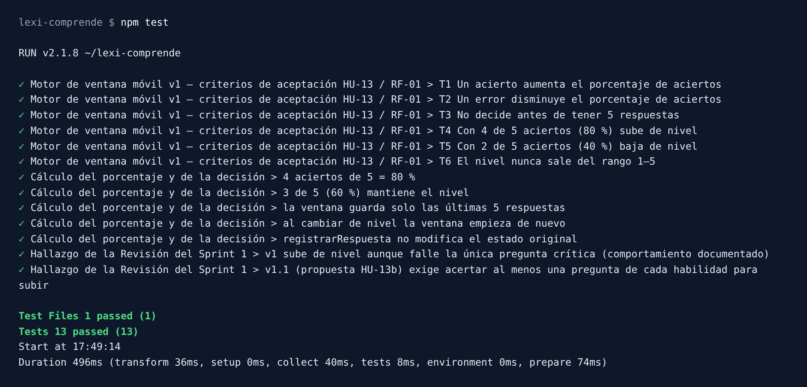

# Lexi Comprende — Incremento del Sprint 1


Lexi Comprende es una PWA de comprensión lectora adaptativa para primaria. Un motor adaptativo sube o baja el nivel de los textos según los aciertos recientes de cada estudiante.

**Producto Académico N.° 1 · SCRUM**

| Integrante | Rol |
|---|---|
| Luis Arturo Cuyubamba Nuñez | Scrum Master |
| Magali [Apellidos] | Product Owner |
| Lisset [Apellidos] | Developer |

---

## Para la docente: cómo revisar

| Qué revisar | Dónde |
|---|---|
| **Demo en vivo** | https://r2d2lcuyubamba.github.io/lexi-comprende/ (código de aula: **4B7K**) |
| **Pruebas automatizadas** | Pestaña **Actions** del repositorio: cada cambio ejecuta `npm test` en un servidor de GitHub |
| **Motor adaptativo** | [`src/engine/motor.js`](src/engine/motor.js) |
| **Casos de prueba** | [`src/engine/casosPrueba.js`](src/engine/casosPrueba.js) y [`src/engine/motor.test.js`](src/engine/motor.test.js) |
| **Pruebas en la app** | En la demo, enlace *"Panel de pruebas del motor adaptativo"* → **Ejecutar pruebas**, simulador de sesión y cálculo paso a paso |

<p>
  
  
  
  
</p>

---

## Qué incluye el Sprint 1

| Historia | Qué hace | Archivo principal |
|---|---|---|
| HU-19 · RF-04 | Ingreso con código de aula + avatar, sin correo ni contraseña; cada avatar guarda su propio progreso en el dispositivo | [`Ingreso.jsx`](src/components/Ingreso.jsx), [`perfiles.js`](src/perfiles.js) |
| HU-01 | Inicio con "Aventura del Día", nivel y logros | [`Inicio.jsx`](src/components/Inicio.jsx) |
| — | Lector de textos | [`Lector.jsx`](src/components/Lector.jsx) |
| HU-05 · RF-02 | Retroalimentación que cita el texto, pista y segundo intento | [`Preguntas.jsx`](src/components/Preguntas.jsx) |
| HU-13 · RF-01 | Motor adaptativo de ventana móvil de aciertos | [`motor.js`](src/engine/motor.js) |
| Pruebas | 7 casos de aceptación, 13 pruebas Vitest y un panel con simulador y cálculo paso a paso | [`casosPrueba.js`](src/engine/casosPrueba.js), [`motor.test.js`](src/engine/motor.test.js), [`PanelPruebas.jsx`](src/components/PanelPruebas.jsx) |

El contenido piloto son 3 lecturas (niveles 1 a 3) con 15 preguntas literales, inferenciales y críticas, en [`lecturas.js`](src/data/lecturas.js).

## Motor adaptativo: ventana móvil de aciertos

El nivel se decide con las **últimas 5 respuestas** del estudiante en su nivel actual. Solo cuenta el primer intento de cada pregunta.

| Aciertos en la ventana | Porcentaje | Decisión |
|---|---|---|
| 4 o 5 de 5 | ≥ 80 % | Sube de nivel |
| 3 de 5 | 60 % | Mantiene el nivel |
| 0, 1 o 2 de 5 | ≤ 40 % | Baja de nivel |

- Con menos de 5 respuestas todavía no se decide.
- Al cambiar de nivel, la ventana empieza de nuevo.
- Los niveles van de 1 a 5.

**Ejemplo:** Lucía, en el nivel 2, responde ✓ ✓ ✗ ✓ ✓. Son 4 aciertos de 5, es decir 80 %, así que sube al nivel 3.

### Resultado de las pruebas



| Caso | v1 (Sprint 1) | v1.1 (propuesta HU-13b) |
|---|---|---|
| T1 Un acierto aumenta el porcentaje de aciertos | ✅ | ✅ |
| T2 Un error disminuye el porcentaje de aciertos | ✅ | ✅ |
| T3 No decide antes de tener 5 respuestas (RF-01) | ✅ | ✅ |
| T4 Con 4 de 5 aciertos (80 %) sube de nivel (RF-01) | ✅ | ✅ |
| T5 Con 2 de 5 aciertos (40 %) baja de nivel | ✅ | ✅ |
| T6 El nivel nunca sale del rango 1–5 | ✅ | ✅ |
| T7 No sube si falla todas las preguntas de una habilidad | ❌ | ✅ |

**Hallazgo de la Revisión del Sprint 1:** con v1, un estudiante puede subir de nivel con 80 % aunque falle la única pregunta crítica de la lectura (✓✓✓✓✗). La historia HU-13b (Sprint 2) lo corrige: para subir, el estudiante tendrá que acertar al menos una pregunta de cada tipo.

## Cómo ejecutarlo en tu computadora

Requiere Node.js 18 o superior, solo como herramienta de desarrollo de la app React. El servidor del proyecto será PHP con Laravel (Sprint 2).

```bash
npm install        # instala dependencias
npm run dev        # abre la app en http://localhost:5173
npm test           # ejecuta las 13 pruebas automatizadas del motor
npm run build      # genera la versión de producción en /dist
```

## Estructura

```
src/
├── engine/        motor de ventana móvil, casos de prueba y pruebas Vitest
├── components/    pantallas (Ingreso, Inicio, Lector, Preguntas, Resultado, PanelPruebas)
├── data/          lecturas piloto, preguntas y pistas
├── perfiles.js    progreso de cada avatar en el dispositivo
└── App.jsx        navegación e integración con el motor
.github/workflows/ci.yml   pruebas automáticas + publicación en GitHub Pages
docs/              capturas y script de prueba de extremo a extremo (Playwright)
```

## Pendiente para próximos Sprints

- **Sprint 2:**
  - HU-13b: acertar cada tipo de pregunta para poder subir de nivel.
  - Panel docente (HU-06, HU-07, HU-20).
  - API en PHP 8.3 + Laravel 11 + MySQL, con autenticación Sanctum y datos cifrados (HU-11, HU-15).
  - Corrección de 2 hallazgos de usabilidad.
- **Sprint 3:** modo sin conexión con IndexedDB y sincronización (HU-03, HU-14), y asignación y carga de textos (HU-08, HU-12). En el Sprint 1 el progreso de cada avatar se guarda en el `localStorage` del navegador; en el Sprint 2 pasa a cuentas en el servidor.
- **Sprint 4:** glosario, medallas y reportes para familias (HU-17, HU-02, HU-10, HU-09, HU-18).
